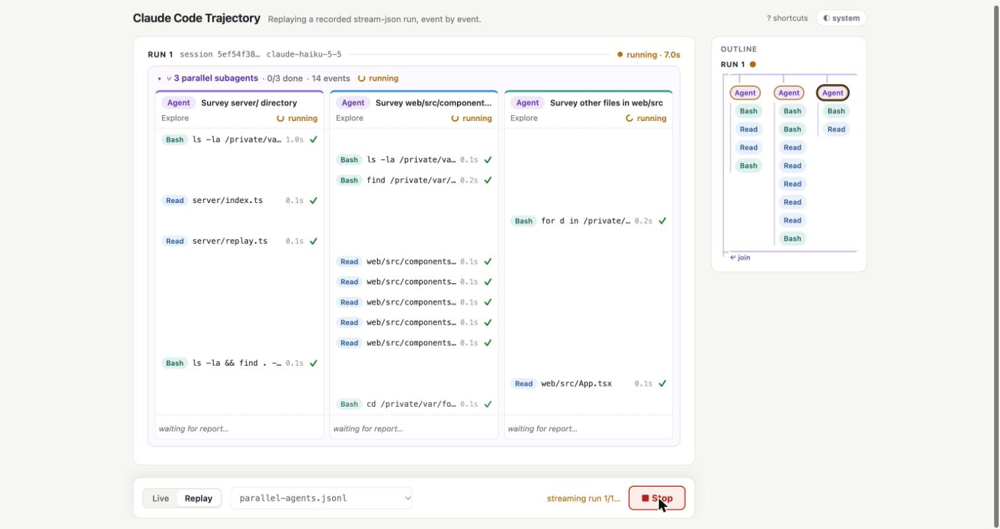

# cc-trajectory

**A live web UI for [Claude Code](https://docs.claude.com/en/docs/claude-code/overview).** Run the `claude` CLI
headless from your browser and watch the agent's trajectory as it happens: every message, tool call and result,
file diffs, subagents working in parallel, and what each run costs. Replay and export sessions afterwards.



You type a prompt and pick a working directory. The server starts Claude Code in headless mode
(`claude -p --output-format stream-json`), forwards its event stream to the browser line by line, and the page
renders the trajectory as it arrives. Follow-up prompts resume the same session, so the agent keeps its context.

> This is an independent project. It is not made or endorsed by Anthropic.

## Features

**Following a run**
- Live trajectory: assistant text (rendered as Markdown, streamed word by word) and every tool call with its input.
- Two levels of status: each call is pending until its result arrives, then ✓ or **FAILED**; each run is running,
  finished or failed, and a run that cannot start (e.g. a working directory that does not exist) shows why.
- Live timers for the run and for each pending call, plus a "thinking…" line while the model is working on its
  next step.
- Stop button (or `Esc`) that ends the agent process.
- Cost, wall-clock time and turn count for every finished run. Claude Code reports cost per session, so the page
  shows each run's own share next to the session total.

**Reading results**
- Long results are folded. Failing commands show their *last* lines, where the error is, with failure and test
  summary lines highlighted. This also works when the command itself exits 0, as with `pytest | tail`.
- Edits and file writes show as a red/green diff with a `+a −b` count.
- `Read` results show as syntax-highlighted code with line numbers.
- Task tools (`TodoWrite`, `TaskCreate`, `TaskUpdate`) show as checklists.

**Subagents and navigation**
- Subagent events nest under the call that started them. The group stays open while the subagent works and folds
  when it is done.
- Subagents started together run side by side in time-aligned lanes: one row per event, so you can see how they
  take turns. Their reports join back into the main agent at the bottom.
- An outline beside the dialogue maps the whole trajectory, including forks and joins. It highlights where you are
  reading, and clicking a step jumps to it. On narrow windows it folds away.

**Sessions**
- Every live session is recorded to `recordings/<session-id>.jsonl`. Reloading the page restores it, and you can
  keep going.
- Download a session as JSON lines, or replay it later at reading speed in Replay mode.

**Comfort**
- Light and dark themes (follows the system, or pick one).
- Keyboard shortcuts:

  | Key | Action |
  |---|---|
  | `j` / `k` | Next / previous step |
  | `⌘K` / `Ctrl+K` | Focus the prompt |
  | `Esc` | Stop the running agent, or close a dialog |
  | `?` | Show the shortcuts |

## Requirements

- Node.js 20.19+ or 22.12+
- [Claude Code](https://docs.claude.com/en/docs/claude-code/setup) installed, with `claude` on your `PATH`, and
  signed in (or `ANTHROPIC_API_KEY` set). The page uses whatever `claude` in your terminal would use.

## Getting started

```bash
git clone https://github.com/AdamLTy/cc-trajectory.git
cd cc-trajectory
npm install
npm run dev
```

Then open <http://127.0.0.1:8787>.

- **Live** mode: enter a working directory (for example `~/scratch/some-repo`) and a prompt, then press Enter.
  Type a follow-up to continue the same session, or press **New session** to start over (the working directory
  is locked while a session is open, because a resumed session must run where it started).
- **Replay** mode: pick a recording and press **Replay**. Each press plays the next run of the session. The
  `fixtures/` directory ships a few examples: tool errors, long outputs, a background subagent, two and three
  parallel subagents, and a stream cut off mid-run.

## Security

**The agent runs with `--dangerously-skip-permissions`.** In headless mode nobody is there to approve a command or
a file edit, so the server lets Claude Code act without asking. That means it can run any command and change any
file the working directory gives it access to.

- Point it at a scratch directory or a repository you can reset, not at your home directory.
- The server only listens on `127.0.0.1`. Do not expose it to a network: anyone who can reach the page can run
  commands on your machine.

## Configuration

| Variable | Default | Effect |
|---|---|---|
| `PORT` | `8787` | Port the server listens on (always on `127.0.0.1`) |
| `REPLAY_DELAY_MS` | `120` | Pause between events when replaying a recording |
| `CC_IGNORE_API_KEY` | unset | Set to `1` to drop `ANTHROPIC_API_KEY` from the agent's environment, so it always uses your signed-in Claude account |

Adding `?model=<name>` to the page URL (for example `?model=haiku`) runs live prompts on that model. This is
handy for trying the page cheaply.

## How it works

```
browser ── POST /api/run {cwd, prompt, sessionId?} ──▶ node server ── spawn ──▶ claude -p … --output-format stream-json
   ▲                                                       │                       --verbose --include-partial-messages
   └──────────── NDJSON stream, one event per line ◀───────┘◀──── stdout ─────────  [--resume <sessionId>]
                                                           │
                                                           └──▶ recordings/<sessionId>.jsonl
```

- The server (`server/`, plain `node:http`) validates the working directory, starts `claude`, and writes each
  stdout line to the response as soon as it is complete. It adds a few events of its own: `{"type":"server",
  "subtype":"error"}` when a run cannot start or dies before its result, `"exit"` when the process ends, and
  `"prompt"` at the start of each run in a recording. Closing the request (Stop, reload) ends the process.
- The page (`web/`, React + Vite) reads the stream and feeds each event into one pure reducer
  (`web/src/trajectory.ts`). Partial-message events grow the text while it is written; the complete assistant
  event finalizes it. Tool results attach to their call by `tool_use_id`. Subagent events attach to the `Agent`
  call named by `parent_tool_use_id`. Agent calls requested in the same assistant message form a parallel group.
- Replay serves the same NDJSON from a file, split into runs at each session start, with a delay between lines.

### Project layout

```
server/
  index.ts       HTTP routes: /api/run, /api/replay, /api/fixtures, /api/recordings/:id, and Vite in middleware mode
  runner.ts      starts claude -p and streams its output
  recorder.ts    appends a live session to recordings/
  replay.ts      reads a recording and splits it into runs
web/src/
  trajectory.ts  the reducer: events → runs → items (text and tool calls) with status, timing and stats
  events.ts      the subset of stream-json the page reads
  App.tsx        layout, live/replay control flow, scroll following, session restore
  components/    ToolCall, ToolResult, DiffView, RichResults, ParallelGroup, Outline, Composer, …
fixtures/        example recordings used by Replay mode
```

## Development

```bash
npm run dev         # server + Vite with hot reload on http://127.0.0.1:8787
npm run typecheck   # TypeScript, no emit
```

Replay mode is the fast way to work on rendering: it costs nothing and runs in seconds. To capture a new fixture,
run a real session and copy its file from `recordings/` into `fixtures/`, or record directly:

```bash
claude -p "<prompt>" --output-format stream-json --verbose > fixtures/my-run.jsonl
```

## License

[MIT](LICENSE)
